# MotivoAI: product case studies

**Clark (Qingjie) Shen**: a product manager who designs, builds and ships with AI coding tools.

From March to November 2026 I built MotivoAI on my own. It is an AI media platform for car dealerships: it turns the photos staff take on the lot into studio-quality listings, makes videos from them, and gives the team an AI agent they can talk to. I found the problems with dealers, decided what to build, designed it, wrote the code with Claude Code, shipped it to the web, iOS and Android, and measured what happened.

Section 4 is a second, smaller product: **Atelier**, a prototype that turns an interior designer's hand-measured sketches and AutoCAD drawings into checked floor plans and a 3D walkthrough.

The code is private because MotivoAI is a commercial product. This page shows the product, the decisions behind it and the numbers. I'm glad to walk through the code live on a screen share.

| | |
|---|---|
| **Products** | MotivoCast web app (Next.js) and iOS/Android app (Expo), the AI engine (Python, FastAPI), dealer websites (Next.js) |
| **Built by** | Me, alone, with Claude Code |
| **Shipped** | 1,164 commits and 164 merged pull requests, March to November 2026 |
| **Tested** | about 1,985 automated tests across the three codebases |
| **Live** | [cast.motivoai.ca](https://cast.motivoai.ca) (sign-in required) · [motivoai.ca](https://motivoai.ca) |

The problem space is close to a property platform's: listings, photos and video, data feeds (each store's inventory goes out to AutoTrader and CarGurus) and consumer-facing websites.

---

## 1. Lot photos into studio-quality listings

**The problem.** Dealers photograph cars where they stand: other cars behind them, rain, signs, half a building. A studio costs money and days, and every listing site shows those photos first.

**What I decided**

- **Change the scene, never the car.** Badges, colour and every scratch stay the dealer's own.
- **One scene per store, used for every car**, so a whole inventory looks like one showroom. The dealer's plate can be swapped for their own.
- **Videos from the same photos:** walkaround, fast-paced, 360°, rolling shots, a talking presenter, or "recreate this video" from a link.
- **Simple pricing:** one credit an image, twelve a video, refunded automatically when a job fails.

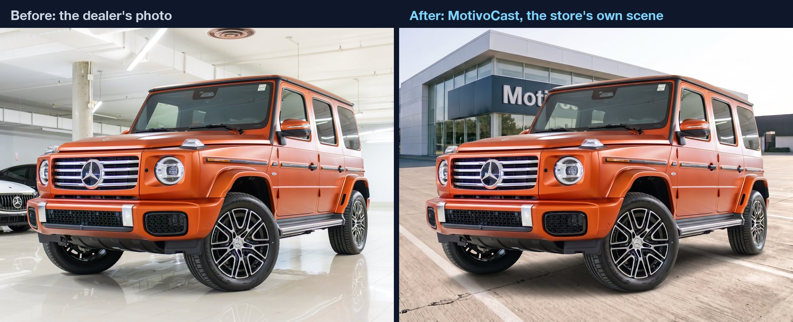
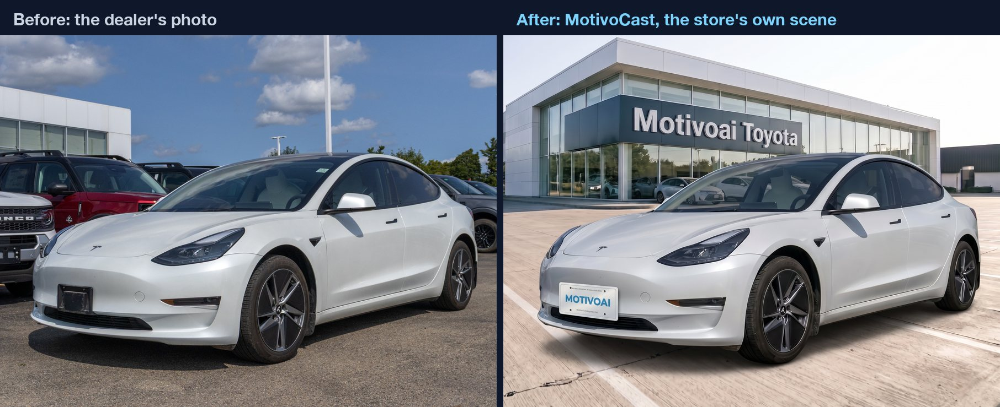
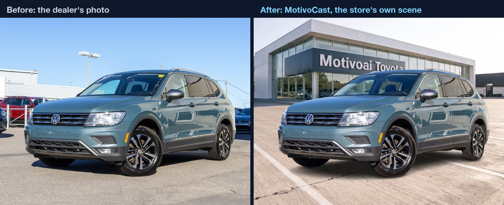

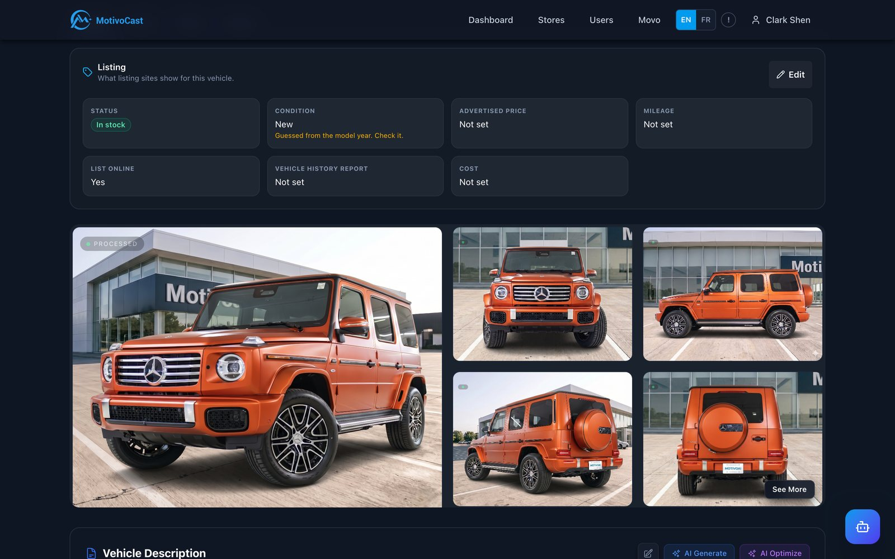

**What I measured and what it changed**

- **Images work.** Over 99% of production background jobs succeed. A car's batch of photos comes back in a median of 38 seconds (90th percentile: 97 s).
- **Videos were the weak spot.** Nothing checked a clip before the dealer saw it. I added three automatic checks: structure, garbled text, and judgement (car cropped, people in shot, someone else's brand). I ran them in **observe-only mode** first, to measure both the defect rate and the checks' own false alarms before letting them block anything a customer had paid for. They flagged most of the early clips. The most common problem was garbled badge text, for example an F-150 redrawn as an "E-150".
- **What changed because of it:**
  - Two prompt rules, each held by a test: never make text the subject of a shot, and never ask the model to copy lettering.
  - A rule that a shot list never names an angle nobody photographed.
  - After a side-by-side test, the default video model moved to Gemini Omni. The previous model stays as a fallback, switchable without a deploy.
- **Next:** let the checks block bad clips once their false-alarm rate is known. Video jobs still succeed less often than images (about two in three).

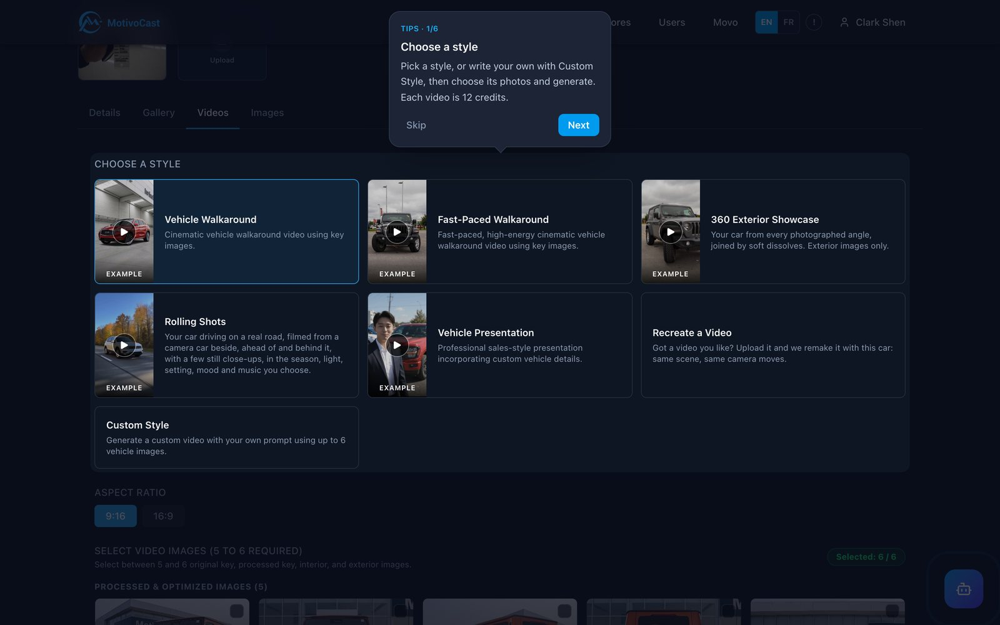

---

## 2. Movo: an AI agent that can't act without a person

**The problem.** The people who need answers are on the lot with a camera or a set of keys in their hand: "which cars still need photos?", "make a video of the Bronco", "write the Ram's description". The dashboard is a few screens away, and managers want the morning report without signing in.

**What I built**

- One agent across web chat, the mobile app, email, live voice calls and scheduled jobs. It has 50+ tools: search inventory, process photos, make videos, write descriptions, run promotions, change the dealer's website.
- **It can never do more than the person asking.** Every tool goes through the same permission checks as the app's own API.
- Each dealership can rename it (it's Movo by default) and give it standing instructions.
- Before anyone's first message, the app says what goes to Google's Gemini and asks for consent.
- **An MCP server with OAuth,** so Claude, ChatGPT or Codex can work in MotivoCast as the signed-in user, within that user's permissions.

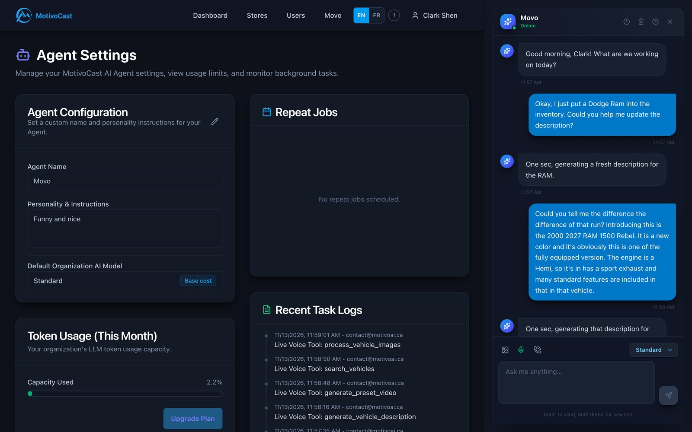

**The decision that shaped it.** In October, Movo showed "Confirm (12 credits)" and started the video in the same turn, so the dealer was charged before anyone answered. Telling the model to ask first wasn't enough. Now an action that deletes something or spends credits doesn't run from the conversation at all:

- Movo gets back "waiting for the user".
- The app shows a card that says exactly what will happen and what it costs.
- Only the person pressing Confirm runs it, through a signed, single-use token the model never sees.

Website changes and promotions follow the same rule: Movo proposes, a person publishes.

| | | |
|---|---|---|
| 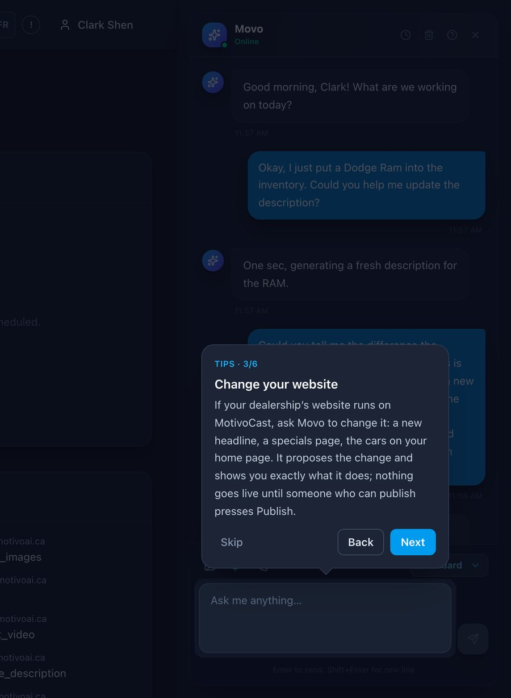 | 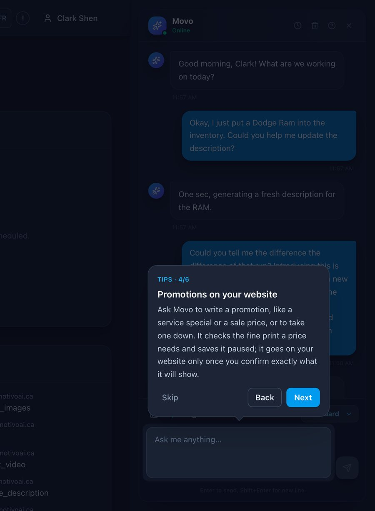 | 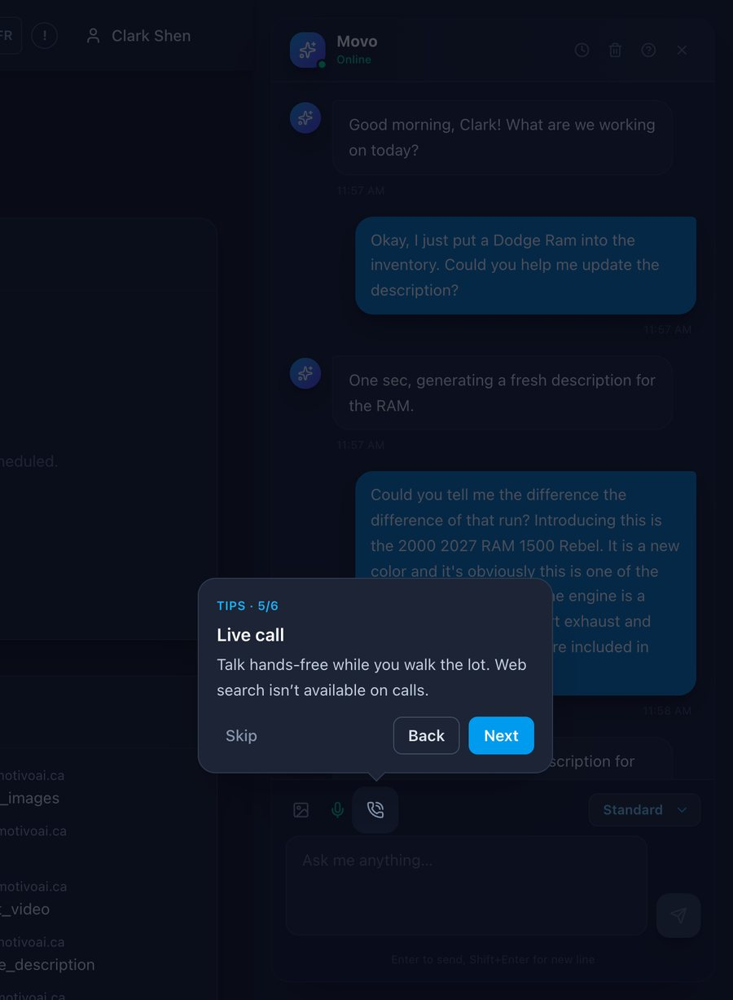 |

**What the usage told me.** About half of the conversations were live voice calls, and most of the rest came from the phone. Very few were typed on the website. People on the lot talk to Movo; they don't type. So voice got the investment: a call continues the chat that's already open, knows which page you're on, and writes every turn into the conversation. Every destructive action requested so far was confirmed by a person before it ran. This is early usage, mostly from my own demos and a pilot dealer group.

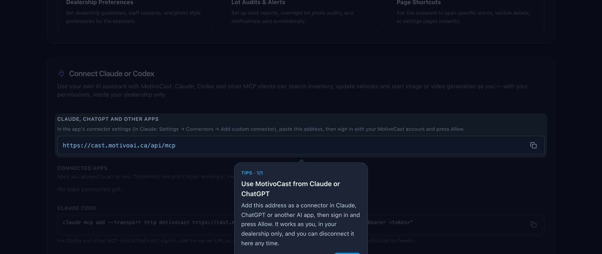

---

## 3. The photographer's app, and a tour that ships with every feature

**The problem.** Lot photographers aren't power users. The AI scenes only line up when every car is shot from the same angles. And a feature nobody notices doesn't exist.

**What I built**

- **A camera for the job.** It runs in landscape and names each shot. It draws the car's outline for its body shape (a sedan is framed as a sedan, a pickup as a pickup). It has 0.5× / 1× / 2× lenses and layouts for both phones and tablets.
- **A spotlight tour** on the web and in the app. The first time a screen opens, its tips dim the screen and light up the real buttons one at a time, scrolling to each. There are 33 tips in English and French, each aimed at the platforms and roles it applies to. They're written once and shared by both apps.

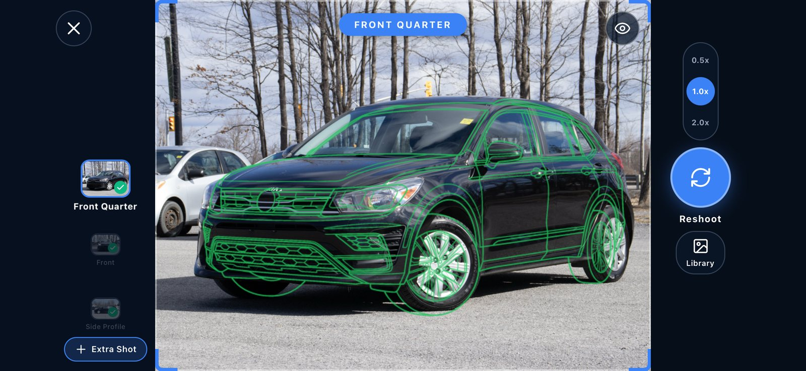
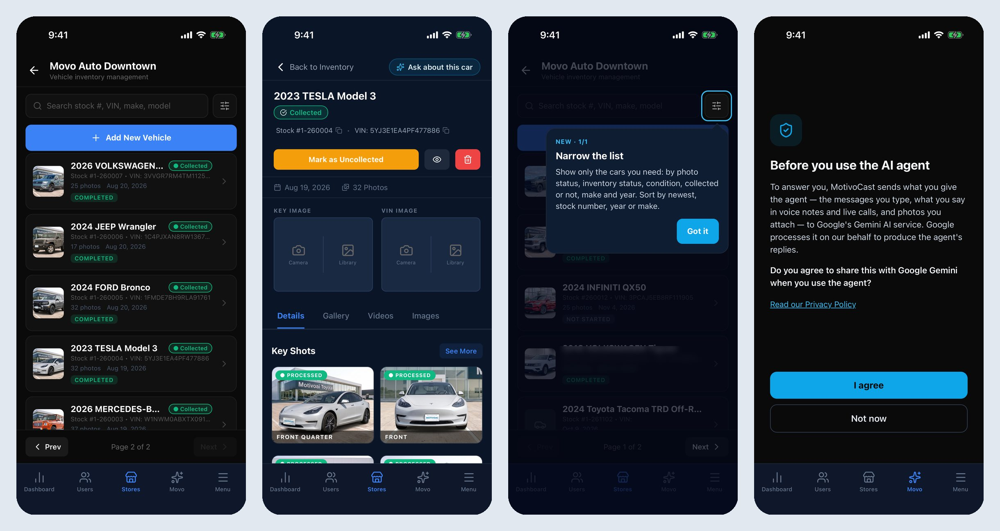

*Left to right: a store's inventory; a car with its processed key shots and "Ask about this car"; a tip marked NEW, shown the next time the screen opens after the feature ships; and the consent screen shown before anything goes to an AI model.*

| | |
|---|---|
| 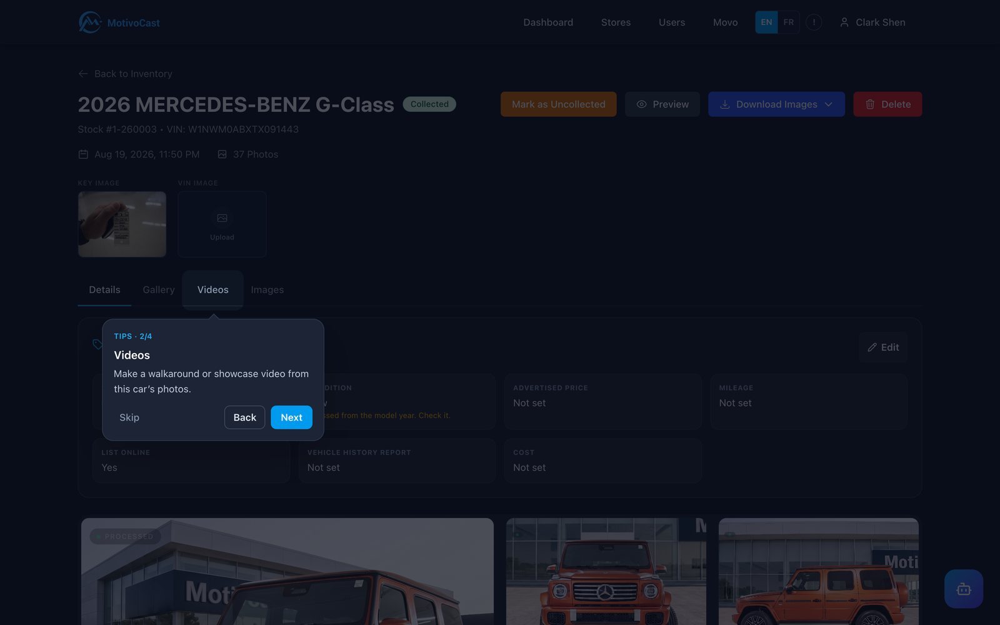 | 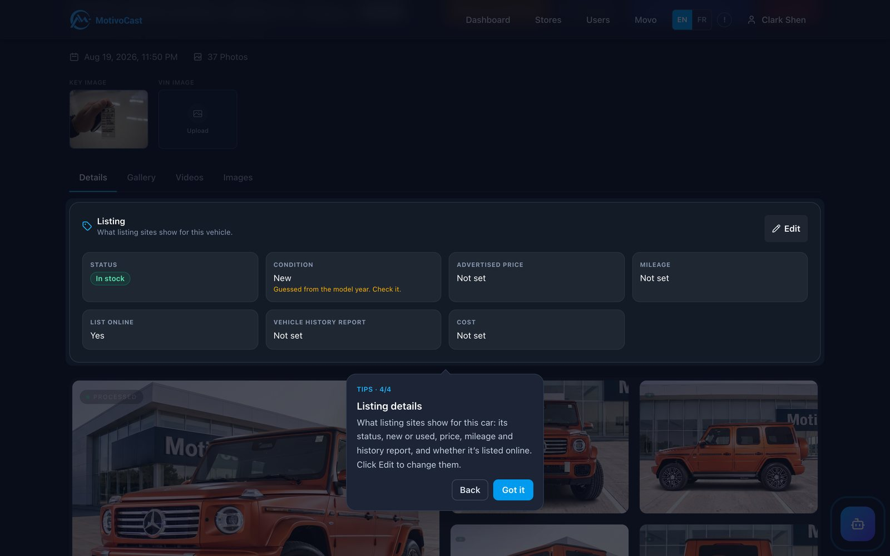 |

**The process decision.** A tour goes stale the first time someone ships without updating it, so the tour is part of "done". The project's rules, which Claude Code follows, say every user-visible feature ships with its tip in the same change. The tests fail if a tip points at a button that no longer exists.

**Next to measure:** how many people finish each screen's tips, and whether toured features get used more than the rest.

---

## 4. Atelier: from a hand-drawn sketch to a floor plan and 3D (prototype)

**The problem.** A residential interior designer in China measures every house by hand on paper and draws it in AutoCAD. Before he can design anything, the same house gets drawn again, and the numbers have to be checked by eye.

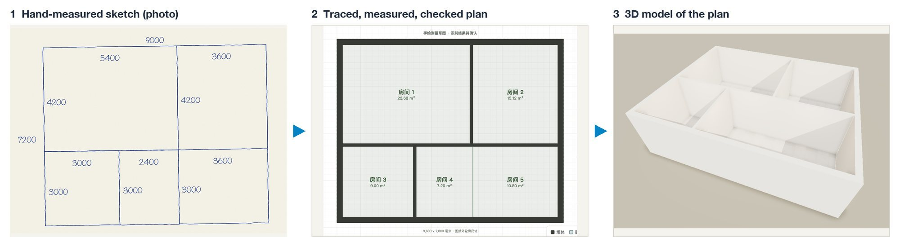

*The sketch here is made up for this page. The flow and the screens are the real app.*

**What I decided**

- **Let AI do only what it does reliably.** In testing, models that read a whole sketch at once (ByteDance's Seed and Alibaba's Qwen) put real numbers on the wrong walls. So the work is split:
  - The designer traces the rooms on the photo, which takes seconds and needs no AI.
  - The AI only finds the handwritten numbers.
  - Plain code matches each number to its wall, flags likely misreads (75750 read for 5750), and fills a missing length from the room's other sides.
- **Check, don't guess.** Every plan is checked in code: dimension chains that don't add up (a 70 mm gap on the sample house), wall thicknesses nobody has confirmed, rooms that overlap. The designer confirms each one; nothing is silently "fixed".
- **Built for his machine and his tools.** The interface is in Chinese and the app works offline. It runs on his 2012 MacBook, reads his AutoCAD files in the app without uploading them, and exports DXF that AutoCAD and the Chinese CAD tools open. The AI key stays in the macOS Keychain.

| | |
|---|---|
| 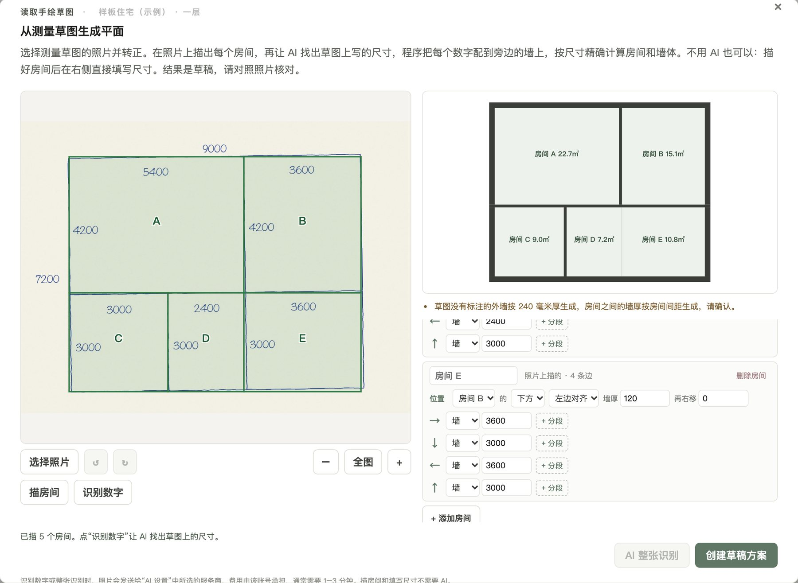 |  |

**What I built, in about a week:**
- Import of AutoCAD drawings that recognizes walls, windows, doors, columns, stairs, beams and ceilings.
- The sketch reader.
- A 3D walkthrough with stairs and lighting.
- DXF export.
- 47 automated tests.

On the designer's two real drawing sets, the recognized walls matched every dimension mark on both floors of one house. On the other house they matched 46 of 58, and the other 12 point where the drawing itself has no line.

**Where it stands:** a prototype the designer hasn't started using yet. **Next to measure:** the time from a sketch to a confirmed plan on one real house, and how many numbers he has to correct.

---

## How I build with AI

I work in Claude Code. What makes it dependable is the rules, written down where every session reads them:

- **Bug fix:** first a test that reproduces the bug and fails, then the fix.
- **Feature:** its tests and its tour tip ship in the same change.
- **Before any pull request,** a hook runs every test (about a second) and blocks the PR if one fails. Tests are never loosened to get past it.
- **Logic lives in plain functions,** outside the React components, so it can be tested.
- **Decisions are written down with their reasons.** The engine's wiki says why each policy exists (for example, "observe before enforcing"), so the next session, human or AI, doesn't undo it.

The result: 1,164 commits, 164 merged pull requests and about 1,985 automated tests in eight months, by one person.

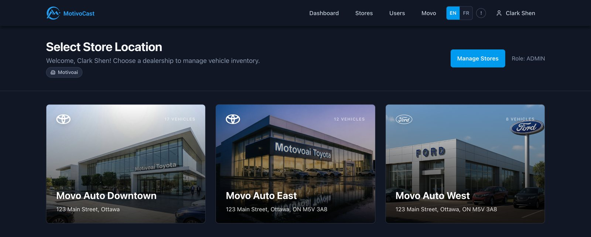
